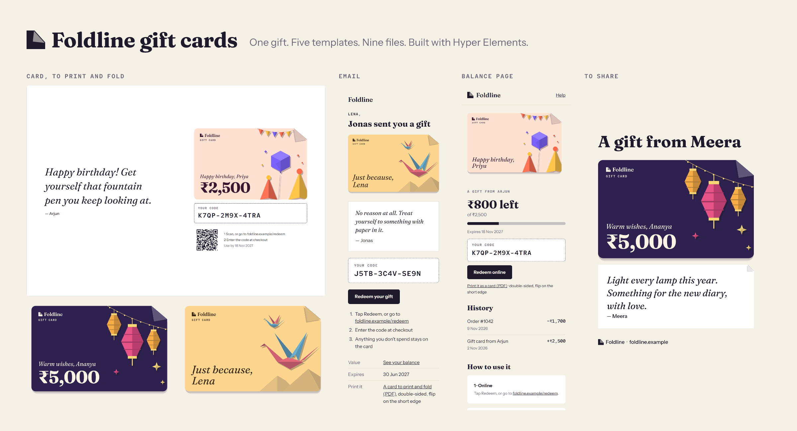
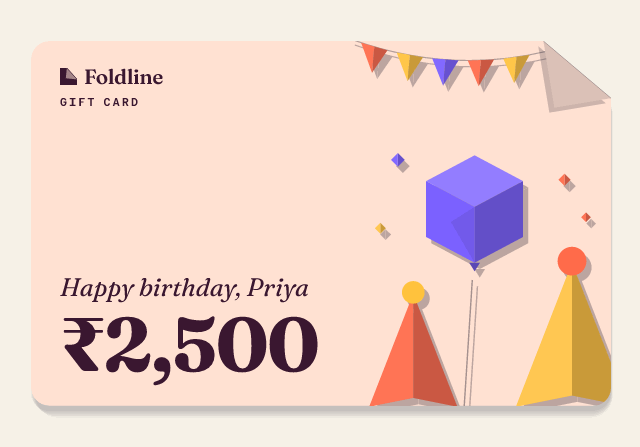
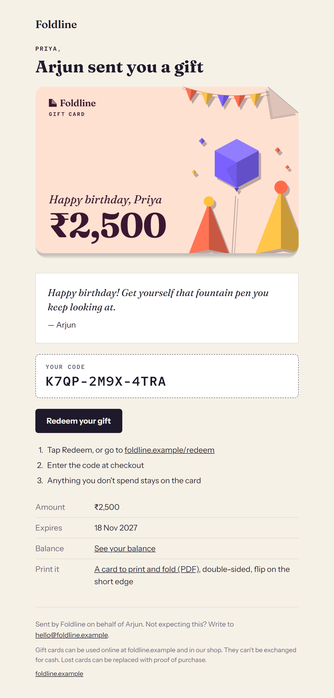
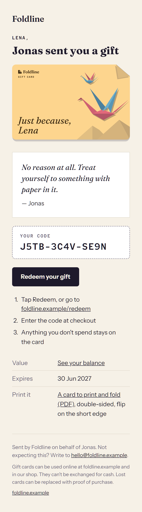
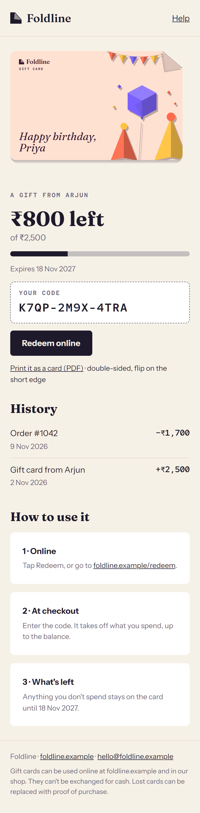
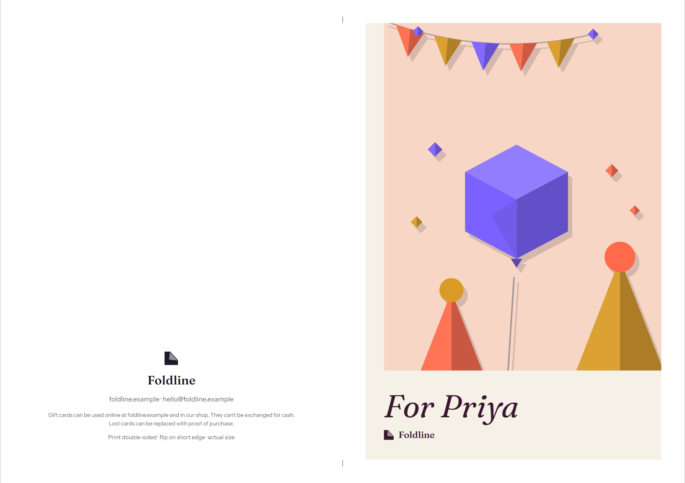
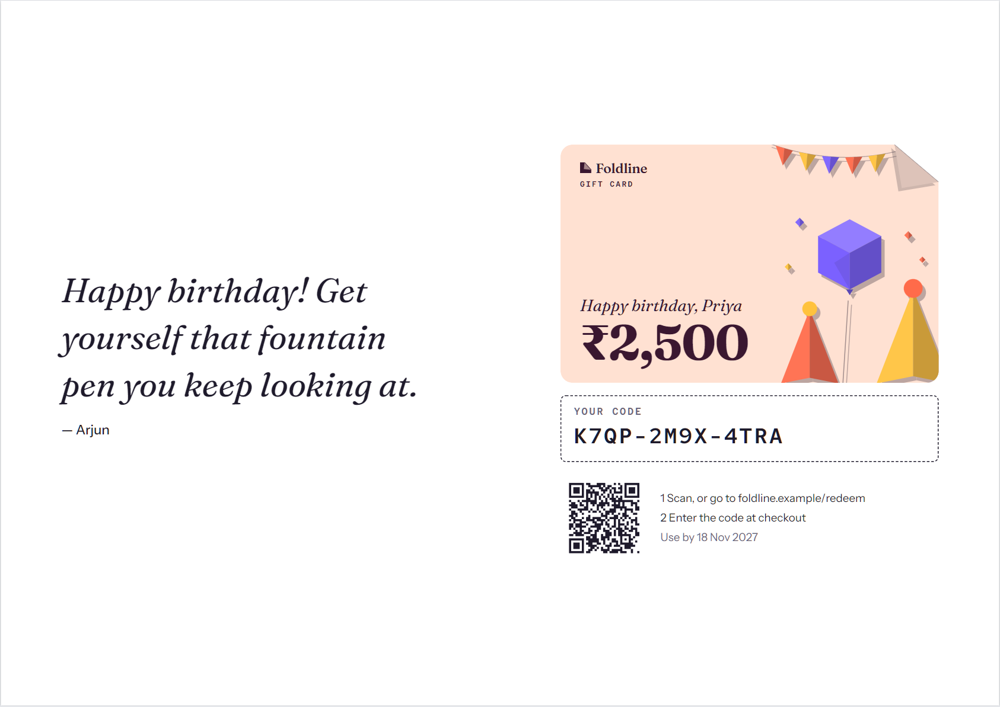
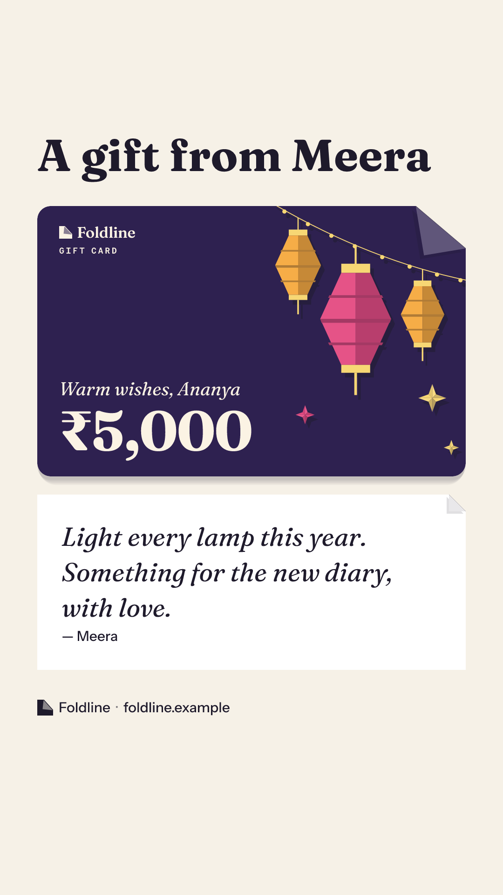

# Foldline gift cards

**One gift's values become its whole set: the card, the delivery email, the balance page, a card to print and fold, and images to share.** Five [Hyper Elements](https://github.com/hyper-elements/hyper-elements) templates share one set of typed fields, one card component and one brand.



Foldline is a fictional paper shop, and every gift card it sells is a piece of folded paper. Each occasion has its own origami: party hats and a water-bomb balloon for a birthday, tulips for thank you, paper lanterns for the festive season, a paper plane for congratulations, cranes for no reason at all. The card's corner is folded along an off-axis crease, the same fold as the shop's mark. The printable card really folds: print it double-sided, fold it once, and it's an A5 greeting card with the gift card inside.



## What one gift makes

`npm run render` turns each file in [`gifts/`](gifts) into nine files in `out/<gift>/`:

| Output | Files | Template | Root |
|---|---|---|---|
| The card face | `card-even.png` · `card-flush.png` · `card-drop.png` | `foldline.GiftCardImage` | `Canvas`, 3 formats |
| Images to share | `share-square.png` (1080²) · `share-story.png` (1080 × 1920) | `foldline.GiftShare` | `Canvas`, 2 formats |
| The delivery email | `email.html` · `email.txt` | `foldline.GiftEmail` | `Email` |
| The balance page | `page.html` | `foldline.GiftBalance` | `Page` |
| A card to print and fold | `card.pdf` (A4, or US Letter for en-US) | `foldline.GiftFoldCard` | `Document`, 2 formats |

| Email (desktop) | Email (phone, value hidden) | Balance page (phone) |
|---|---|---|
|  |  |  |

| The printable card, outside (back · front) | Inside (the note · the gift) |
|---|---|
|  |  |

| Share, square | Share, story |
|---|---|
|  |  |

The balance page on a desktop is in [`docs/page.png`](docs/page.png).

## Quick start

You need **Node 22 or newer**.

```bash
npm ci
npm run render
```

Open `out/priya-birthday/email.html`, `page.html` and `card.pdf`. The first run downloads the fonts once from fonts.gstatic.com, so it needs an internet connection.

To make your own, copy `gifts/priya-birthday.json` to `gifts/your-gift.json`, change the values, and run:

```bash
npm run render -- your-gift
```

If a value can't be used, nothing is written and the reason is printed beside its field:

```
✗ your-gift
    to: “MAXIMILIAN WOJCIECHOWSKI-MONTAGU” is too long to fit on the card: try a shorter form of the name.
```

## How Hyper Elements is used

### Five templates, one set of fields

Every output is a [`template()`](https://hyperelements.dev/docs/templates) with typed fields, an example, guidance and rules. All five take the same fields ([`src/fields.ts`](src/fields.ts)), so one gift's values check against every template and render the whole set.

```tsx
export const fields = {
  occasion: prop.choice(OCCASIONS_LIST, { label: "Occasion", required: true, guidance: "Sets the card's art, colours and greeting." }),
  amount: prop.number({ label: "Amount", required: true, min: 1, max: 100000, integer: true }),
  to: prop.text({ label: "To", required: true, maxLength: 32, pattern: PRINTABLE, guidance: "The recipient's name as they'd sign it. It has to fit the card on a line of its own." }),
  code: prop.text({ label: "Gift code", required: true, pattern: `^${CODE}-${CODE}-${CODE}$` }),
  showAmount: prop.boolean({ label: "Show the amount", default: true }),
  // … from, message, expires, redeemUrl, balance, history, shopName, terms and more
};
```

```tsx
const formats = { even: frameSize("even"), flush: frameSize("flush"), drop: frameSize("drop") };

export default template({
  id: "foldline.GiftCardImage",
  version: "1.0.0",
  label: "Gift card image",
  root: "Canvas",
  formats,
  fields,
  example,
  rules: { require: { core: ["image/overflow", "image/glyph"] } },
  render(v, { format }) {
    assertPrintable(v); // the rules a pattern can't say: a name too wide for the card, an emoji…
    const size = formats[format];
    return (
      <Canvas width={size.width} height={size.height} fonts={FONTS} lang="en">
        <Card {...v} frame={format} />
      </Canvas>
    );
  },
});
```

The templates use template formats for sizes: `even`, `flush` and `drop` for the card image, `square` and `story` for shares, and `a4` and `letter` for the printed card.

### Every root, one card

The card is one component ([`src/parts/Card.tsx`](src/parts/Card.tsx)) built from `Layer`, `Svg` shapes and a clipped `Column`. The same component is drawn by four roots:

- **`Canvas`** for the card image and share images, written with `renderImage()`. The email embeds the card image.
- **`Page`** for the balance page, with the card's value hidden so the balance is the only number on the page.
- **`Document`** for the fold-in card, written with `renderPdf()`: two `Document.Page`s, with a QR code drawn as one `Svg` path.

The origami is data: polygons, circles and curves in [`src/art/`](src/art). Each piece is drawn twice, once as its shadow and once in its colours, and a string's lanterns hang exactly where they meet its curve.

The email and the page share one `defineTheme()` ([`src/brand.ts`](src/brand.ts)) with element defaults and named styles (`eyebrow`, `sheet`). Phone styles (`mobile`) and `hidden={{ mobile: true }}` handle the layout on phones.

### Rules, so nothing breaks

- Fields carry their rules: `maxLength`, `pattern` (the characters the fonts can draw, the gift-code alphabet), `min` and `max`.
- What a pattern can't express, a template's `render` refuses, so `check()` reports it as an error. Examples: a name too wide for the card, an emoji in a message, a note that can't fit a share image. [`problems()`](src/fields.ts) gives the same rules as sentences a shop can show.
- The image templates require the core rules `image/overflow` and `image/glyph`, and every image is rendered `strict`: a missing glyph or anything past the canvas is an error, not a warning.

### Text, measured

Every size and line break on the card, the PDF and the share images is decided by measuring with the fonts' own glyph widths. [`npm run metrics`](scripts/metrics.ts) reads them once from the same TrueType files the renderers use and writes them to [`src/metrics.json`](src/metrics.json). Measuring is synchronous, so a template's `render` can use it on every root:

- **Amounts:** `100.000 €`, `₹1,00,000` and `$100,000` all fit the card at the largest size that fits.
- **Names:** a long name breaks after the greeting's comma.
- **Notes:** a note takes the largest size from 44px down to 28px that fits. If it still doesn't fit, the card shrinks; a note is never cut.
- **Line breaks:** on images and PDFs the template sets every line break itself, at spaces only, because the renderer may break a line wherever the font changes, even mid-word. One-letter words stay with the next word, and widows are avoided.

Each font weight is a single TrueType file from fonts.gstatic.com holding Latin, Latin Extended-A and ₹ together with its kerning. It goes in each root's `fonts` prop, as the official gallery's templates do, so a word never changes font file part-way. Hindi names and notes are set in Martel.

### The CLI

```bash
npm run check      # hyper-elements check: all five templates, every format, with their examples
npm run describe   # hyper-elements describe: the card template's formats, fields, guidance and rules
npx hyper-elements preview out/priya-birthday/email.html --findings   # the email in Outlook, Gmail, Apple Mail
```

`package.json` lists the templates as trusted (`"hyperElements": { "templates": ["src/**"] }`).

```
Gift card image (foldline.GiftCardImage 1.0.0, a Canvas): The gift card's face as a PNG: origami art for the occasion, the greeting, the amount, a folded corner.
  One card per gift. The amount is fitted to the card; names must fit it on a line of their own.
  formats: even 1084×710, flush 1042×672, drop 1012×672
```

## Make it yours

### The fields

| Field | What it is | Rules |
|---|---|---|
| `occasion` | `birthday`, `thanks`, `festive`, `congrats` or `justBecause` | sets the art, colours and greeting |
| `amount`, `currency` | the value, in INR, USD, EUR or GBP | a whole number from 1 to 100,000 |
| `locale` | `en-IN`, `en-US`, `en-GB` or `de-DE` | sets how money and dates are written; the copy stays English. `en-US` prints on US Letter |
| `to`, `from` | the recipient and the sender | up to 32 characters; must fit the card at its smallest greeting size |
| `message` | the note | up to 240 characters; Latin, Latin Extended-A or Devanagari; no emoji |
| `code` | the gift code | `XXXX-XXXX-XXXX`, with no I, L, O or U |
| `expires`, `redeemUrl` | when it ends, and where to redeem it | `redeemUrl` is the button and the printed QR code |
| `balanceUrl`, `printUrl`, `cardImageUrl` | the balance page, the PDF, the hosted card image | links in the email and on the page |
| `balance`, `history`, `asOf` | what's left, what it was spent on, the day the page is for | for the balance page; `asOf` after `expires` shows it expired |
| `showAmount` | `false` hides the value | on the card, the share images, the email and the printed card |
| `barcode` | what a shop's till scans | shown on the page as a QR code |
| `shopName`, `shopUrl`, `supportEmail`, `terms` | your shop | Foldline is the default. For another shop the wordmark stands alone, without Foldline's mark |

### Sending the email

The email shows the card image by `cardImageUrl`. Rendered locally, it points at `card-drop.png` next to `email.html`. To send it, host `out/<gift>/card-drop.png` and set `cardImageUrl` to its address. The code is live text in the email, so it can still be read with images turned off.

### A new occasion

Add a palette and greeting to `OCCASIONS` in [`src/brand.ts`](src/brand.ts), and a composition to [`src/art/compose.ts`](src/art/compose.ts) built from the pieces in [`src/art/pieces.ts`](src/art/pieces.ts). The art lives in the right 45% of the card and keeps clear of the text and the folded corner.

## Printing the card

Open `card.pdf` and print it double-sided, flipped on the short edge, at actual size (100%), then fold it in half. Every sheet edge keeps 10 mm clear and the fold a 20 mm band, so nothing is lost to a home printer or wraps round the fold. Small ticks at the top and bottom mark the fold.

## Tested

`npm test` runs 16 tests, among them:

- every template's example in every format, rendered without errors;
- the card in a `Canvas`, a `Page` and a `Document` for every occasion;
- an edge-case matrix of twelve hard gifts through all nine outputs: the largest amounts in every currency, the longest names, a 238-character note and no note, Hindi, Polish, Turkish and Romanian, twenty history rows, spent and expired cards, and another shop;
- with `showAmount` off, the email shows the value nowhere: not in the preheader, the alt text, the details or the plain text;
- every text colour against its background meets WCAG AA contrast (4.5:1).

The email was previewed in Outlook, Outlook.com, Gmail and Apple Mail, light and dark, with `hyper-elements preview`. The rendered files come out byte-identical on Windows and Linux and on Node 20, 22, 24 and 26.

## Scripts

| Command | What it does |
|---|---|
| `npm run render` | Renders every gift in `gifts/` (or the ones named) into `out/` |
| `npm test` | The tests |
| `npm run check` | `hyper-elements check` on every template |
| `npm run describe` | `hyper-elements describe` for the card template |
| `npm run typecheck` | TypeScript |
| `npm run screenshots` | Screenshots of each email and balance page at desktop and phone widths (needs Chrome or Edge installed) |
| `npm run docs` | The pictures in `docs/`, made from `out/`; the hero is itself a Hyper Elements `Canvas` (needs Chrome or Edge) |
| `npm run metrics` | Re-measures the fonts into `src/metrics.json` |

## Project structure

```
src/
  templates/   card-image · share · email · page · fold     the five template() designs
  parts/       Card · Mark · Qr                            drawn by several templates
  art/         shapes · pieces · compose                   the origami, as data
  fields.ts    the typed fields every template takes, and the rules as sentences
  text.ts      measuring, fitting, wrapping, the printable-text and name rules
  brand.ts     Foldline's palette, the occasions, the email and page theme
  fonts.ts     the fonts (fonts.gstatic.com) and their cache
  format.ts    dates, short links, a gift's shop
gifts/         five example gifts
scripts/       render · screenshots · docs · metrics
test/          kit.test.tsx
```

## Known limits

- The card's art has fixed sizes, so on the balance page the phone card is 336px wide, sized for a 375px phone. At 390px it sits 14px short of the column.
- Email clients without web fonts (Gmail, Outlook) fall back to Georgia, Arial and Consolas. Classic Outlook squares off the rounded corners.
- `npm audit` reports six moderate advisories, all from `fflate` inside `satori`, with no fix available upstream.

## License

[MIT](LICENSE). The fonts are Fraunces, Instrument Sans, Red Hat Mono and Martel from Google Fonts, under the SIL Open Font License; they're downloaded at first run, not included here.
